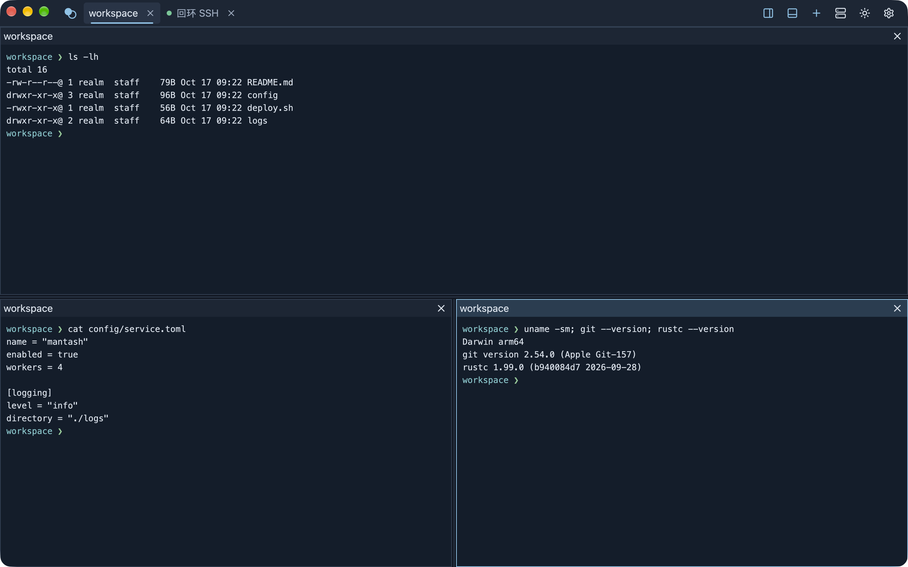
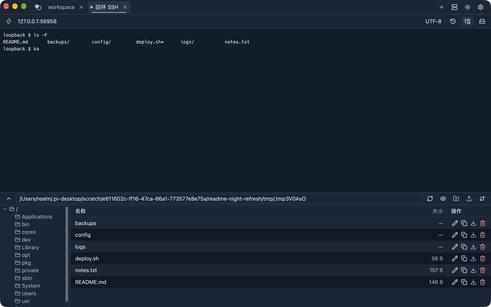
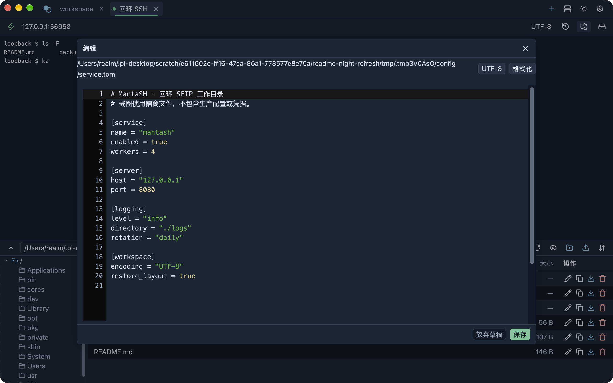
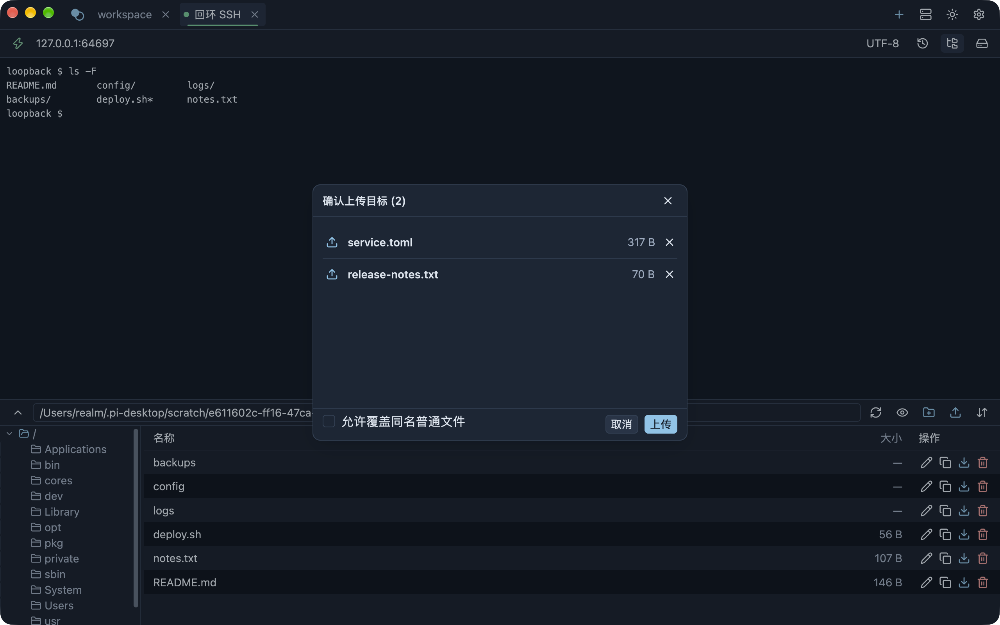
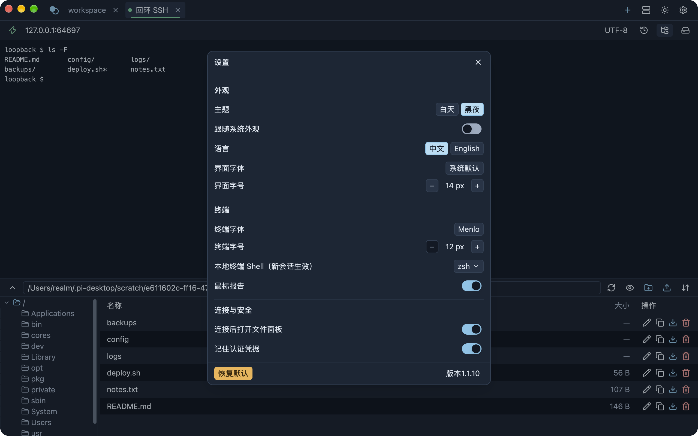

# MantaSH

[English](README.en.md)

**MantaSH** 是基于 Rust 和 GPUI 的原生终端工作台，将本地 Shell、SSH、远程文件、编辑和 Linux 主机监控集中在一个窗口中。

[](https://github.com/realmx/mantash/actions/workflows/ci.yml) [](LICENSE)

## 安装

macOS 可用 Homebrew 安装；已安装最新版本时重复执行只会提示无需升级。更新使用 `brew upgrade --cask mantash`。

```sh
brew install realmx/taps/mantash --cask
```

也可从 [GitHub Releases](https://github.com/realmx/MantaSH/releases) 下载对应架构的包。macOS 打开 DMG 后将应用拖入 Applications；Windows 运行安装器。

| 平台 | 架构 | 发布包 |
|---|---|---|
| macOS | Apple Silicon | `MantaSH-X.Y.Z-macos-arm64.dmg` |
| macOS | Intel | `MantaSH-X.Y.Z-macos-x64.dmg` |
| Windows | x86 | `MantaSH-X.Y.Z-windows-x86-setup.exe` |
| Windows | x64 | `MantaSH-X.Y.Z-windows-x64-setup.exe` |
| Windows | ARM64 | `MantaSH-X.Y.Z-windows-arm64-setup.exe` |

`X.Y.Z` 对应发布 tag；每个包附有 `.sha256`。macOS 包仅 ad-hoc 签名、未经公证，首次打开可能被 Gatekeeper 拦截；核对来源后按[用户手册](docs/user-guide.md)使用系统“仍要打开”，不要关闭安全检查。Windows 安装器未签名，SmartScreen 可能提示确认；Windows 实机安装与运行尚未验收。不提供便携 ZIP。

## 核心能力

- 本地 PTY、多标签与 Shell 集成；每个本地标签最多 5 个左右、上下或混合窗格，SSH 不分屏。
- SSH 密码认证、主机指纹确认、断开重连和本机加密凭据；连接库支持搜索、排序、克隆、多选及 CSV 导入导出。
- SFTP 浏览、复制、重命名、删除、上传下载、后台传输与记录；在线编辑支持 8 MB 内普通文本、严格编码、草稿及可撤销基础格式化。
- SSH 共享命令历史，支持搜索、复制、填入和明确执行；Linux 远端提供资源、进程、端口详情及确认后的进程结束操作。
- 中英文、明暗主题、系统外观跟随、字体字号、工作区恢复，以及确认后下载、校验和安装的自动更新。

完整入口与限制见[功能与范围](docs/features.md)和[用户手册](docs/user-guide.md)。SSH 仅密码认证；旧式 RSA 主机密钥已追加兼容配置，真实旧版服务器仍待专项验收。目录上传、传输自动续传和重启后的编辑草稿恢复不在当前功能范围内。

## 开始使用

启动后进入本地 Shell；点击加号新建本地标签。通过“连接”添加 SSH 资料，连接前请经可信渠道核对主机指纹。

连接资料支持 `name,host,port,username,password` 五列 CSV 导入导出；导出密码为明文，请按敏感文件处理。重启后本地标签启动新的 Shell，SSH 需手动重连，编辑草稿不保留。详见[用户手册](docs/user-guide.md)。

## 界面预览

以下为 macOS 原生窗口实拍，五张截图统一使用黑夜主题。截图使用隔离数据目录与真实回环 SSH/SFTP 服务，端口、临时路径和文件仅属于测试环境，不含生产凭据。窗口为 1280×800，图片保留 2× Retina 分辨率；拍摄构建与证据范围见[验收记录](docs/acceptance.md#readme-原生截图)。











## 开发与发布

源码运行需要 Rust 1.89 或更新版本，以及对应平台的 C/C++ 工具链；首次构建需要下载依赖。平台准备见[开发文档](docs/development.md)。

```sh
git clone https://github.com/realmx/MantaSH.git
cd MantaSH
cargo run --locked
```

检查命令、专项测试和隔离原生 QA 统一见[开发与验证](docs/development.md#必做检查)。`Cargo.toml` 保持源码版本基线；源码变更推送到 `master` 后由 workflow 创建版本 tag 并派发发布，纯文档更新跳过。版本规则、签名和安装包流程见[发布文档](docs/release.md)。

## 文档与许可

[文档索引](docs/README.md)汇总用户手册、开发、架构、数据、平台和验收记录；另见[贡献指南](CONTRIBUTING.md)。项目采用 [GPL-3.0-or-later](LICENSE)，第三方许可见[第三方声明](THIRD_PARTY.md)。
